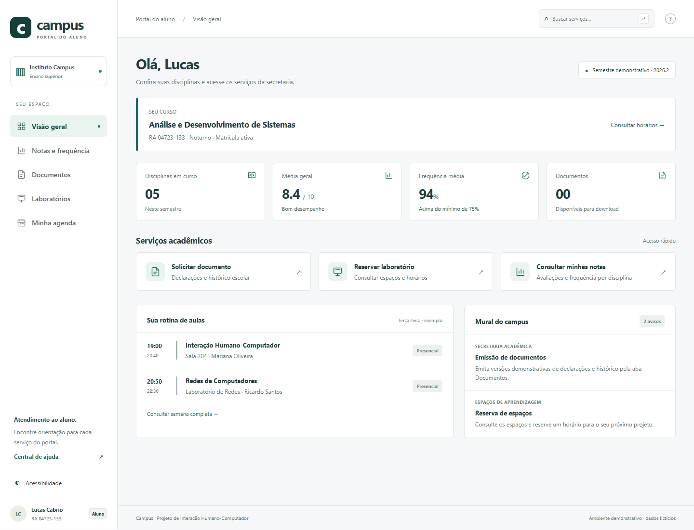

# Campus — Portal do Aluno

Projeto final de **Interação Humano-Computador**: proposta de portal escolar com consulta de notas e frequência, solicitação de documentos e reserva de laboratórios.

**Lucas Cabrio — 04723-133**  
**Paulo Esteves — 04723-090**

Repositório: https://github.com/LucasCabrio/campus-portal-ihc



## Abrir no VS Code

1. Instale Node.js 20 ou superior.
2. Abra esta pasta no VS Code (Arquivo → Abrir pasta).
3. No terminal integrado, execute:

```sh
npm start
```

4. Acesse **http://localhost:3000**. Não precisa executar `npm install`: o aplicativo usa somente recursos nativos do navegador e do Node.js.

Se a porta estiver ocupada, no PowerShell:

```powershell
$env:PORT=4173
npm start
```

Ou pressione **F5** no VS Code; a configuração incluída usa a porta 4173. Para desenvolvimento com reinicialização do servidor: `npm run dev`. Recarregue a página depois de editar os arquivos. Não abra `index.html` diretamente: módulos JavaScript precisam do servidor HTTP.

## Organização modular

```text
public/
  app.js                  # Inicialização, rotas e busca
  data.js                 # Dados acadêmicos de demonstração
  domain.js               # Regras de reserva, média e escape de texto
  index.html              # Estrutura compartilhada
  legacy.html             # Referência anterior SIMULADA
  styles.css              # Importação dos módulos de estilo
  styles/
    base.css              # Tokens, tipografia e foco
    layout.css            # Menu, cabeçalho e estrutura
    components.css        # Formulários, tabelas, cartões e diálogos
    responsive.css        # Adaptações e apresentação
  components/
    icons.js              # Ícones SVG
    ui.js                 # Cabeçalhos, notificações, diálogo e download
  services/
    storage.js            # Estado e persistência local
  pages/                  # Um módulo por tela
    dashboard.js
    grades.js
    documents.js
    laboratories.js
    agenda.js
    help.js
    accessibility.js
server.mjs                # Servidor estático local
tests/domain.test.mjs      # Regras de negócio
scripts/browser-qa.cjs     # Testes de integração e screenshots
scripts/generate-report.py # Geração do relatório em PDF
docs/                     # Processo de IHC e evidências
output/pdf/               # PDF final
```

Cada tela exporta `render()` e, quando necessário, `bind(refresh)`. As páginas usam a camada `storage.js` para alterar o estado. As regras de reserva são independentes do DOM e testadas isoladamente. O CSS também está dividido por responsabilidade.

## Funcionalidades

- Painel com vínculo acadêmico, médias, frequência, serviços e avisos.
- Consulta de cinco disciplinas, duas avaliações e frequência.
- Emissão demonstrativa de documentos em `.txt`, protocolo, download e cancelamento.
- Reserva de três espaços; prevenção de datas inválidas, horários passados e conflitos locais.
- Confirmação antes de cancelar; horário liberado após cancelamento.
- Agenda semanal e reservas confirmadas.
- Busca por serviços e central de ajuda.
- Contraste reforçado, ampliação, foco visível por teclado e link para pular conteúdo.
- Persistência das solicitações, reservas e preferências no navegador.

## Testes

```sh
npm test
```

Para repetir os testes de navegador, instale opcionalmente Playwright e seu navegador (essas ferramentas não são necessárias para usar o portal):

```sh
npm install --no-save playwright
npx playwright install chromium
```

Com o servidor ativo na porta 4173, execute `node scripts/browser-qa.cjs`. Para outra porta, configure `BASE_URL`. O script usa contexto isolado, recria os screenshots e salva `docs/test-results.json`. `BROWSER_CHANNEL=msedge` permite usar o Edge instalado. Resultados da execução entregue: **7 testes unitários e 13 verificações de navegador aprovados**.

## Documentação de IHC

- Relatório explicativo em PDF: disponível localmente em `output/pdf/Campus-Relatorio-IHC.pdf`, sem versionamento no GitHub. Para gerar uma cópia, siga as instruções abaixo.
- [Pesquisa, personas, jornada e avaliação](docs/processo-ihc.md)
- [Roteiro de teste](docs/roteiro-teste.md)
- [Planilha de coleta em CSV](docs/coleta-usabilidade.csv)
- [Evidências dos testes técnicos](docs/test-results.json)

A equipe informa que o sistema foi validado e testado informalmente por familiar próximo. Esse relato não é apresentado como estudo controlado. Não foram fornecidas medidas de tempo, respostas SUS ou observações individuais. Personas e dores são hipóteses de projeto; a página `/legacy.html` é uma referência criada para comparação, não uma auditoria de sistema real.

## Limites do protótipo

Não há autenticação, backend acadêmico, banco compartilhado, envio de e-mails nem integração institucional. Os dados são fictícios, salvo os nomes e RAs dos autores, fornecidos para identificação do trabalho. Downloads não têm validade oficial. As reservas existem apenas neste navegador, sem controle de concorrência entre usuários. Não use o projeto para dados escolares reais. A interface adota recursos de acessibilidade, sem declarar conformidade integral com WCAG.

## Gerar o PDF novamente

Com Python e as bibliotecas `reportlab` e `Pillow` disponíveis:

```sh
python -m pip install reportlab Pillow
python scripts/generate-report.py
```

Os screenshots precisam existir em `docs/screenshots/`. Para inspeção visual do PDF, renderize as páginas com Poppler (`pdftoppm`).
